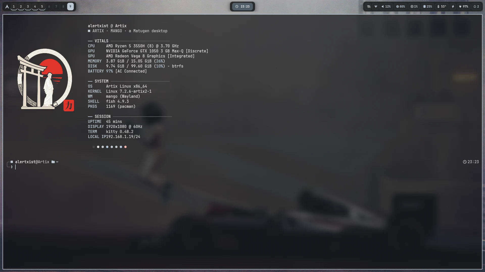
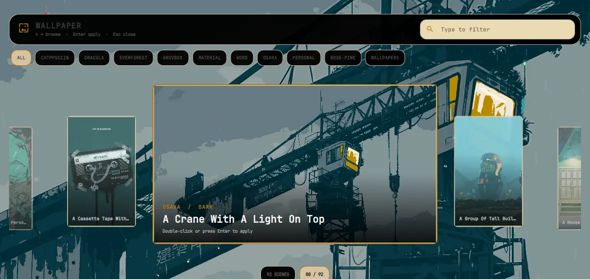
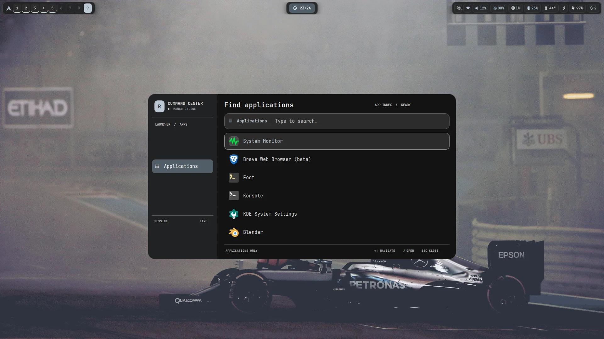
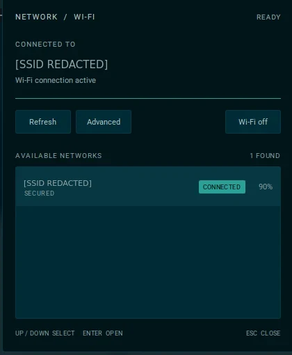
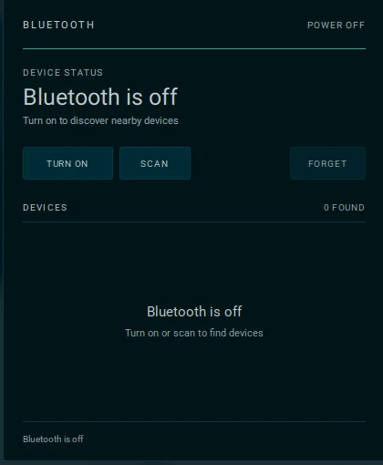
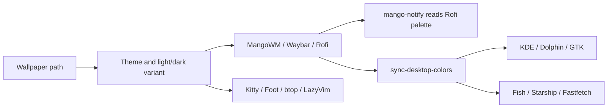

<div align="center">

# MangoWM Dotfiles

**A cohesive, wallpaper-driven Wayland desktop for Arch Linux, CachyOS, and Artix Linux.**

[](https://archlinux.org/) [](https://wayland.freedesktop.org/) [](https://github.com/mangowm/mango)



<sub>MangoWM · Waybar · mango-notify · Rofi · Kitty · btop · LazyVim · systemd / OpenRC</sub>

<br><br>

[Showcase](#showcase) · [Features](#highlights) · [Install](#installation) · [Keybindings](#keybindings) · [Architecture](#dynamic-theming)

</div>

## Showcase

<table>
  <tr>
    <td width="50%">
      
      <br>
      <sub><b>Wallpaper gallery</b> — search, browse, preview, and recolor the complete desktop.</sub>
    </td>
    <td width="50%">
      
      <br>
      <sub><b>Command center</b> — a focused Rofi launcher using the generated palette.</sub>
    </td>
  </tr>
</table>

### Instrument popups · current Osaka palette

<table>
  <tr>
    <td width="50%"><br><sub><b>Wi-Fi</b> — connection, scan, and network actions.</sub></td>
    <td width="50%"><br><sub><b>Bluetooth</b> — power-off state and device controls.</sub></td>
  </tr>
</table>

Captured from the live Qt popups; the Wi-Fi SSID is redacted before publication. Popup accents and surfaces follow the active theme.

> One wallpaper selection regenerates a consistent palette across the compositor, shell, terminal, launcher, notifications, GTK, KDE, and folder icons.

This repository is an audited snapshot of the active desktop—not a loose collection of example configs. It excludes credentials, caches, generated binaries, and stale settings from other desktop sessions; the bundled wallpaper collection is an explicit exception to the personal-media exclusion. The complete inclusion policy lives in [`AUDIT.md`](AUDIT.md).

## Desktop stack

| Layer | Choice |
|---|---|
| Distribution / init | Arch Linux or CachyOS / systemd; Artix Linux / OpenRC |
| Login / session | SDDM / Wayland |
| Compositor | MangoWM |
| Bar / notifications | Waybar / mango-notify (native C++ / Qt Quick) |
| Launcher / terminal | Rofi / Foot (default), Kitty |
| Browser | Brave Origin (stable) |
| Shell / prompt | Fish / Starship |
| Wallpaper / colors | Custom Qt gallery / curated named palettes |
| Audio / network | PipeWire + WirePlumber / NetworkManager |
| Desktop integration | Dolphin + KDE colors + GTK3/GTK4 CSS |

## Highlights

- **One-command recoloring.** Named wallpaper folders apply curated palettes to MangoWM, Waybar, mango-notify, Rofi, Kitty, Foot, btop, LazyVim, Fish, Starship, Fastfetch, KDE, GTK, and Breeze folder icons; ungrouped wallpapers use Material Dark.
- **Consistent terminal workflow.** Rofi, btop, and Neovim open through Foot; Neovim owns text and source-code MIME types.
- **Purpose-built desktop tools.** Native Qt notifications and desktop controls, wallpaper gallery, Wi-Fi, Bluetooth, power-profile and battery information popups, plus a volume/brightness OSD.
- **Responsive workflow.** Nine tags, directional navigation, touchpad gestures, blur, animations, scratchpads, and a compact status bar.
- **Selectable Waybar layouts.** Switch between three floating islands and a unified dock from the status module; the choice survives installer refreshes.
- **Event-driven status.** Custom Mango tag indicators update from compositor IPC instead of polling through `jq`.
- **Audited deployment.** The installer adapts hardware names, builds local tools from source, configures distro-appropriate services, and backs up every conflict.
- **Repeatable installation.** Identical files and matching symlinks are left untouched, making subsequent installs idempotent.

## Installation

### Supported target

The normal package and service setup supports `/etc/os-release` IDs `arch` and `cachyos` (systemd) and `artix` (OpenRC). Other systems can use config-only installation with the skip options below.

### Normal installation

```bash
git clone https://github.com/alertxsto/mangowm-dotfiles.git ~/mangowm-dotfiles
cd ~/mangowm-dotfiles
./install.sh
```

The installer may request `sudo` for packages and system services (`systemctl` on Arch/CachyOS, `rc-update`/`rc-service` on Artix). It runs AUR package builds as the regular user.

On a terminal, the installer opens a keyboard-driven selection screen with
the `alertxsto` wordmark. Use **Up/Down** or **j/k** to move, **Space** to
toggle packages, Qt builds, or login services, and **Enter** to review the
plan. On the review screen, **y** starts installation, **e** edits the
selection, and **q** cancels without changing anything. CLI skip options stay
locked; a custom `--target-home` disables login services. The full supplied
wordmark needs a terminal at least 118 columns wide and 26 rows high;
smaller terminals get a compact label. Colors are disabled with `NO_COLOR=1`.

On Artix, the installer first ensures SceneFX 0.5 is available for MangoWM's
wlroots 0.20 dependency. If the enabled Artix repositories do not provide it,
the bundled [`PKGBUILD`](system/packages/scenefx/PKGBUILD) builds the
checksum-verified upstream release as the regular user and installs it through
pacman. No Arch repositories or unmanaged `/usr/local` libraries are added.

Power profiles use the genuine `power-profiles-daemon` package, plus
`power-profiles-daemon-openrc` on Artix. On existing TuneD installations, the
installer stops and disables `tuned` and `tuned-ppd` before replacing the
conflicting `tuned-ppd` provider with PPD in one dependency-checked `yay`
transaction. Approve that replacement prompt in an interactive terminal.
The installer never force-removes a provider, bypasses dependency checks, or
installs a compatibility package; if another package explicitly requires
TuneD rather than the PPD interface, resolve that dependency before retrying.
The old TuneD packages may remain installed but disabled; they are no longer
desktop dependencies.

After installation:

1. Log out.
2. Select **Mango** in SDDM.
3. Log back in.
4. Press `Super+W` to choose one of the bundled wallpapers, or run `theme-wallpaper /path/to/image`.

The installer seeds `~/Pictures/Wallpapers` and `~/Pictures/blinders.jpg` from the repository without replacing existing files. Add more images under `~/Pictures` as desired. A generated fallback palette remains available if no image exists.

### Installer options

```text
--target-home PATH  Install into PATH instead of $HOME
--skip-packages     Do not install pacman/AUR packages
--skip-services     Do not enable systemd/OpenRC services
--skip-build        Do not build the native Qt utilities
--yes               Use selected steps without interactive questions
-h, --help          Show installer help
```

Examples:

```bash
# Install configuration and build Qt tools without package/service changes
./install.sh --skip-packages --skip-services

# Use preselected steps without installer questions (e.g. from a script)
./install.sh --yes --skip-services

# Populate an isolated home for inspection
./install.sh \
  --target-home /tmp/mango-home \
  --skip-packages \
  --skip-services
```

When `--target-home` differs from `$HOME`, use `--skip-services`; user services belong to the real login account. The installer also scopes XDG configuration and data paths to the target home while registering application defaults.

Without a terminal, the installer runs the selected steps without its selection
screen. `--yes` does the same in a terminal; neither mode answers prompts from
`sudo` or `yay`. Replacing an installed `tuned-ppd` requires an interactive
package transaction. That package migration stops and disables the old power
services even with `--skip-services`; the latter skips enabling new services.

## What `install.sh` does

1. Identifies supported systems by `/etc/os-release` ID (`arch`, `cachyos`, or `artix`) for package and service setup.
2. Bootstraps `yay` when necessary.
3. Ensures SceneFX 0.5 on Artix, then installs repository and AUR dependencies listed in [`packages.txt`](packages.txt).
4. In a Git checkout, copies indexed home-tree paths using their working-tree contents; untracked files, including ignored files, are excluded. Without Git metadata, copies the distributed home tree.
5. Replaces `__HOME__` placeholders with the actual target path.
6. Registers Brave Origin, Foot, and Neovim as desktop defaults and restores the selected Waybar layout.
7. Detects the backlight device. The Wi-Fi popup selects an available NetworkManager interface at runtime.
8. Builds the Wi-Fi, Bluetooth, power-profile (`ppd-popup`), battery information, OSD, notification service, and wallpaper utilities from source. Projects build sequentially with at most two compiler jobs to limit memory pressure; QtDBus comes from `qt6-base`, with `qt6-declarative` and `libpulse` providing the notification UI and audio integration.
9. Migrates the power backend to genuine power-profiles-daemon and enables the required system and user services through systemd or OpenRC.

Installing from a Git checkout requires Git. Indexed paths use their current working-tree contents, so new files must be added to the index before a checkout installation can include them.

The battery popup is included in the default Qt build; no prebuilt binary or
additional daemon is required. Its desktop entry is installed with an absolute
path for the selected home, and both Waybar layouts include its click action.
Use `--skip-build` only when native utilities are already available or when
installing configuration for inspection without runnable popup binaries.

On Arch/CachyOS, the installer enables `NetworkManager`, `bluetooth`,
`power-profiles-daemon`, and `sddm` as systemd system units, starts PPD, and
enables the user `pipewire.socket`, `pipewire-pulse.socket`, and
`wireplumber.service`. On Artix, it enables the corresponding OpenRC system
services (including the packaged `power-profiles-daemon` service) and user
D-Bus/PipeWire/WirePlumber services. Before starting PPD, both init paths stop
and disable the old TuneD services. Unowned legacy `/etc/init.d/tuned-ppd` and
`/etc/tuned/ppd.conf` files are moved to timestamped `.pre-ppd-*` backups;
package-owned files are left to pacman. Mango exports Wayland and Qt session
variables to D-Bus and, on systemd hosts, the user service manager before
launching desktop applications.

Artix installs `dbus-openrc`, `pipewire-openrc`, `pipewire-pulse-openrc`, and
`wireplumber-openrc` explicitly so every requested user service is available.
Application defaults are registered in the target XDG config directory without
inheriting the calling desktop's KDE runtime selection.

The power popup reads PPD's `Profiles` and `ActiveProfile` properties over the
system D-Bus API and updates when the daemon emits property changes. Waybar's
`custom/ppd` indicator uses a long-running Python/Gio D-Bus subscription
(`python-gobject`), not a two-second TuneD state-file poll. Clicking it opens
`ppd-popup`; selecting a profile sets PPD's `ActiveProfile` through native
asynchronous D-Bus, without invoking `pkexec`. The daemon's default polkit
policy allows switching without a password in an active local desktop session.
Only profiles reported by PPD are shown.

### Existing-file safety

Changed configuration destinations are moved to a backup before replacement. Existing MIME and terminal-default files are copied to the backup before defaults are registered:

```text
~/.dotfiles-backup/YYYYMMDD-HHMMSS-PID/
```

Identical configuration files and matching symlinks are left in place. Existing MIME and terminal-default files are snapshotted on each install before their contents are updated.

The installer leaves legacy `~/.config/swaync` contents untouched; the native
notification service does not read them. It does not uninstall SwayNC or stop a
running notification daemon.
Sign out and back in after updating so the native service can claim the session
bus without competing with an old daemon. The installed per-user D-Bus activation
entry points `org.freedesktop.Notifications` to `mango-notify`.

## Repository layout

```text
.
├── .config/
│   ├── mango/                 # compositor, rules, bindings, startup
│   ├── waybar/                # switchable bar/dock modules and styling
│   ├── rofi/                  # launcher
│   ├── kitty/                 # alternative terminal and generated palette
│   ├── foot/                  # default Wayland terminal and generated palette
│   ├── btop/                  # generated activity monitor theme
│   ├── nvim/                  # LazyVim setup and generated Mango palette
│   ├── fish/                  # shell startup and generated colors
│   ├── fastfetch/             # generated layout and image
│   ├── gtk-3.0/               # GTK3 palette integration
│   ├── gtk-4.0/               # GTK4/libadwaita integration
│   ├── fontconfig/            # icon-font fallback aliases
│   ├── xsettingsd/            # GTK/XSettings bridge
│   └── xdg-desktop-portal/    # Wayland screen-capture routing
├── .local/
│   ├── bin/                   # shell and Python helpers
│   └── share/
│       ├── network-popup/     # Qt Wi-Fi popup source
│       ├── bluetooth-popup/   # Qt Bluetooth popup source
│       ├── ppd-popup/         # Qt power-profiles-daemon selector source
│       ├── popup-ui/          # shared right-edge popup motion
│       ├── battery-popup/     # Read-only Qt battery information panel
│       ├── mango-osd/         # Qt OSD source
│       ├── mango-notify/      # C++ / Qt Quick notification service and controls
│       ├── wallpaper-overview/ # Qt wallpaper gallery source
│       ├── applications/      # desktop launchers and terminal-first utilities
│       ├── dbus-1/services/   # native notification service activation
│       └── color-schemes/     # KDE fallback color scheme
├── system/                    # pinned package recipes for Artix dependencies
├── AUDIT.md                   # system audit and exclusions
├── packages.txt               # repository, AUR, and Artix/OpenRC packages
└── install.sh                 # installer, builder, and service setup
```

## Dynamic theming



The main entry point is:

```bash
theme-wallpaper /path/to/wallpaper.png
```

Wallpapers under `~/Pictures/Wallpapers/<Theme>/<Dark|Light>/` select the
matching curated palette. Supported families are Catppuccin, Dracula,
Everforest, Gruvbox, Material, Nord, Osaka, and Rose Pine. Images outside that
layout use Material Dark instead of deriving unstable colors from image pixels.

Without an argument, it uses this precedence:

1. The last selected wallpaper from `~/.cache/mango-theme/wallpaper`.
2. `~/Pictures/blinders.jpg` when present.
3. The first supported image under `~/Pictures`.
4. The tracked fallback palette when no image exists.

The theme command reloads MangoWM, Waybar, Kitty, btop, and mango-notify after regenerating colors. The native notification service reads and watches `~/.config/rofi/colors.rasi` directly; it has no separate generated CSS or palette template. Running LazyVim instances watch the generated palette and recolor immediately; Fish reloads its generated colors at the next prompt.

GTK uses portable Adwaita styling with the generated GTK3/GTK4 color overrides;
Qt applications use the generated KDE color scheme instead of Artix-only
`qt5ct`/`qt6ct` theme files. The Waybar launcher and Fastfetch banner use
Mango branding on all three distributions.

### Brave Origin

The package step installs the stable [`brave-origin-bin`](https://aur.archlinux.org/packages/brave-origin-bin)
package, not Brave Beta. The `brave-origin.desktop` entry launches `brave-session`,
which runs only `brave-origin` and retains the session-bus notification fix.
HTML files and HTTP/HTTPS links use Origin by default. An older managed
`brave-browser-beta.desktop` launcher is moved into the installer's backup;
existing Beta packages, browser profiles, bookmarks, and extensions are not removed
or migrated.

`~/.config/brave-origin-flags.conf` selects Qt 6 with `--qt-version=6` and
`--ui-toolkit=qt`; the launcher selects the KDE platform theme. This reuses
`MangoDynamic.colors` and `kdeglobals`, already generated by `theme-wallpaper`,
without another color file, extension, or background service.

After installing, fully quit Origin and reopen it, then select **Use QT** under
**Theme** at `chrome://settings/appearance` once per browser profile. A custom
browser theme can override the system palette. Browser controls use the system
palette; websites retain their own styles.

Do not assume an open browser recolors immediately when the wallpaper changes.
With Origin 1.97.59, the Qt palette was available but an existing window retained
its previous colors until a page reload; restarting Origin also reads the current
palette. The installer does not restart the browser or rewrite profile preferences.


### Foot terminal

Foot is the default terminal for application launchers and the `Super+Return`
binding. Kitty remains installed as an alternative; run `kitty` to open it.

`~/.config/foot/foot.ini` uses Fish, JetBrainsMono Nerd Font at 11 pt, 8 px
padding, a silent bell, and 75% background opacity. It includes the generated
`~/.config/foot/colors.ini`, which supplies the active light/dark theme, ANSI
colors, cursor, selection, and URL colors. The tracked palette is a fallback
for use before the first wallpaper selection.

Fish selects the Sixel logo renderer for Fastfetch when `$TERM` starts with
`foot`; other terminals keep the configured Kitty renderer. This applies to
both the startup banner and interactive `fastfetch` commands and survives
theme regeneration. Open a new Foot window, or run
`source ~/.config/fish/config.fish`, to load this terminal-specific setting.

`theme-wallpaper` regenerates the Foot palette with the other terminal colors.
Open a new Foot window after changing themes; existing windows do not reload
the generated configuration. Terminal selection is not part of the installer.

### Cursor theme

The cursor is declared once, in `~/.config/mango/config.conf`:

```conf
cursor_theme=Bibata-Modern-Classic
cursor_size=24
```

Mango derives `XCURSOR_THEME`/`XCURSOR_SIZE` from those keys for its own pointer
and for every child process. Other toolkits keep private copies, so
`sync-cursor` mirrors the two values into all of them and notifies running
applications:

| Consumer | Store |
|---|---|
| Waybar and other GTK3/GTK4 apps on Wayland | `dconf` `org.gnome.desktop.interface cursor-theme`, served through the settings portal |
| GTK3/GTK4 on X11 and portal-less sessions | `settings.ini` keys |
| GTK2 | `~/.gtkrc-2.0` |
| Qt via the KDE platform theme | `kcminputrc` `[Mouse]` |
| XSettings consumers | `xsettingsd.conf` |
| The theme named `default` | `~/.icons/default/index.theme` |

`sync-cursor` runs at session start and is idempotent. After editing the two
Mango keys, apply them everywhere with:

```bash
sync-cursor
```

Editing only `settings.ini` is not enough: on Wayland, GTK resolves the cursor
through the settings portal, whose value comes from dconf.

### Waybar layouts

Waybar ships with a three-island `bar` profile and a unified floating `dock`
profile. Both use a 38 px height, a 4 px top margin, and no extra bottom
margin; side insets are 6 px for bar and 12 px for dock. Island positions
remain left/center/right rather than being packed together.

The `Bar`/`Dock` status module runs `~/.config/waybar/mode.sh toggle`,
replaces the active config and stylesheet, restarts Waybar, and records the
choice in `~/.config/waybar/.mode`. `install.sh` reapplies that profile after
refreshing the tracked files.

`common.css` owns module spacing, pill-shaped workspace states, hover
feedback, and warning colors for both layouts. The profile stylesheets own
only the outer island/dock shape. All colors come from the generated
`colors.css`, so wallpaper/theme changes preserve the geometry.

The `custom/ppd` power indicator reads the genuine power-profiles-daemon's
`ActiveProfile` property over system D-Bus and subscribes to changes through
Python/Gio. It does not poll state files or run periodic subprocesses.
Clicking the indicator opens `ppd-popup` rather than cycling profiles.

## Custom utilities

### Native notifications

`mango-notify` is the notification daemon itself, not a skin or frontend for
another service. Its C++ backend owns the standard session-bus
`org.freedesktop.Notifications` interface; Qt Quick renders the toast stack and
compact desktop-control panel in one dynamically sized, top-right layer-shell
surface. LayerShellQt supplies real Wayland overlay positioning and resizing;
it does not rely on a compositor floating-window size workaround.
There is no large title banner, background picture, blur, or compositor shadow.
Panel content stays loaded until the close animation finishes, then unloads.

Notifications retain a bounded in-memory history (up to 200 entries), support
application actions, replacement IDs, images, and inline replies, and remain in
history after a toast times out. Restarting the daemon clears this history.
Opening the panel marks history read and hides toasts. Do Not Disturb persists
across restarts; it suppresses normal toasts while retaining history, with
critical notifications still visible.

The panel provides real output volume, speaker and microphone mute, brightness,
Wi-Fi and Bluetooth switches, power-profile status, and MPRIS media controls.
Network, Bluetooth, power-profile, and audio shortcuts open the existing native
popups or `pavucontrol`. State updates are event-driven through PulseAudio,
D-Bus, and file watches, not a loop of shell commands.

Left-click Waybar's notification bell to toggle the panel; right-click to toggle
Do Not Disturb. The module streams JSON from `mango-notify --subscribe`, including
the notification count and DND state in its tooltip. The **Notifications**
application launcher opens the same panel.

```bash
mango-notify --open       # show the panel
mango-notify --close      # hide the panel
mango-notify --toggle     # toggle the panel
mango-notify --dnd        # toggle Do Not Disturb
mango-notify --dnd-on     # explicitly enable it
mango-notify --dnd-off    # explicitly disable it
mango-notify --count      # print retained notification count
mango-notify --clear      # dismiss retained notifications
mango-notify --reload     # reread the shared theme
mango-notify --subscribe  # stream Waybar JSON updates
```

Mango starts `mango-notify --daemon` at login. Per-user D-Bus activation entries
also start it for the standard notification service and its native control
interface. Only one daemon can own the standard bus name; mango-notify reports
a conflict rather than replacing another notification service. Starting it
again when its own service already exists is harmless. CLI control uses
`org.mango.Notifications` at `/org/mango/Notifications` without initializing a
second graphical application. `mango-notify --quit` stops the native daemon.

Backend regression tests cover replacement identity, closure reasons,
retained/transient expiry, DND and critical notifications, resident actions,
inline replies, and bounded history. Run them on a private session bus and
configuration directory:

```bash
build_dir="$(mktemp -d)"
qmake6 "$HOME/.local/share/mango-notify/tests/notificationservice-test.pro" \
  -o "$build_dir/Makefile"
make -C "$build_dir" -j2
dbus-run-session -- env XDG_CONFIG_HOME="$build_dir/config" \
  "$build_dir/notificationservice-test"
```

#### Measured resource comparison

Measured on this Artix desktop with SwayNC 0.12.6 and Qt 6.12.0; the native
application uses Qt Quick's software renderer. Both runs injected five retained
notifications, warmed the panel once, then sampled each state for eight seconds.
Values include the daemon and Waybar subscriber. Existing history was not
cleared, so this is a session before/after comparison, not an isolated benchmark.

| Measurement | SwayNC | mango-notify |
|---|---:|---:|
| Panel closed: PSS (MiB) | 85.58 | 57.81 |
| Panel open: PSS (MiB) | 85.58 | 57.86 |
| Panel closed: summed RSS (MiB) | 126.55 | 130.67 |
| Panel closed: CPU (% of one core) | 0.000 | 0.248 |
| Panel open: CPU (% of one core) | 0.124 | 0.124 |

PSS apportions shared library pages; summed RSS counts those pages in each
process. The native result has lower PSS but slightly higher RSS, and does not
show an idle-CPU reduction in this short sample. Zero recorded CPU ticks are
not a guarantee of permanently zero CPU usage. Raw measurements on this machine
are saved in `~/.local/state/mango-notify/resource-comparison.json`.


### Connectivity popups

`network-popup` is a Qt Quick Wi-Fi frontend backed by `nmcli`.

- Shows the active access point from NetworkManager's in-use marker, even when
  its saved connection profile has a different name.
- Tracks radio and connection changes made outside the popup; refreshes the list
  without freezing the window, and reports failed operations instead of closing.
- Connects to open or secured networks, disconnects, and turns Wi-Fi off or on.
- Lists saved profiles separately by connection name and UUID, showing each
  profile's security; an access point is marked in range only when its advertised
  security matches the profile. Unknown security types may require `nmtui`.
- Shows saved networks that are out of range, connection details, and per-profile automatic connection settings; forgetting a profile requires confirmation.
- Retries saved profiles by UUID, supplying supported passwords through nmcli's
  standard input rather than command arguments. Enterprise configurations
  requiring other credentials should be configured with `nmtui`.
- Opens `nmtui` for advanced configuration.

`bluetooth-popup` is a matching frontend backed by `bluetoothctl`.

- Powers Bluetooth on or off and scans for nearby devices.
- Pairs, trusts, connects, disconnects, and forgets devices.
- Updates paired/connected state after external BlueZ changes without blocking
  the window; keeps paired devices visible when the adapter is off.
- Verifies requested changes and displays errors when BlueZ rejects them.

Launch Wi-Fi, Bluetooth, Power profiles, or Battery from its Waybar module. They enter from the right
in 180 ms (ease-out cubic) and exit to the right in 140 ms (ease-in cubic), without
vertical motion. The shared `popup-ui/PopupWindow.qml` owns the transition;
compositor animations are disabled only for these four windows.
Both `animation_type_open:none` and `animation_type_close:none` are explicit:
Mango's unmap path can still create a close snapshot when only `no_animation`
is set, which otherwise adds an upward slide after the QML exit.

Clicking the same module again, Escape, a window-close request, or moving focus
away uses the same exit animation before the process ends. Focus loss is
debounced for 80 ms, and closing during entry continues from the current position.
The native single-instance socket handles toggle-close without initializing a
second GUI. No animation timer remains active after the panel settles.

### Battery information

Click the Waybar battery indicator to open `battery-popup`. The native Qt Quick
panel uses English labels and the active generated palette, with a Graphite
fallback. It shows charge level, charging/discharging state, approximate time,
power, full/design capacity ratio, and firmware-reported charge cycles.

Expand **Battery details** for design/full capacity, voltage, temperature,
manufacturer, model, technology, and charge thresholds. Details scroll within a
400 × 536 px viewport; the header and close controls remain visible. The viewport
shrinks on shorter screens. This is a read-only panel, not a charging-limit or
power-profile editor.

The details toggle has 12 px internal padding, so its focus border stays clear of
the label. Expanded information sits in a separate card with 14 px padding and
separators between readings, device identity, and charge thresholds. Opening the
card reveals it with a bounded 160 ms scroll; the header and close controls stay fixed.

- Reads the selected system battery and charger state directly from sysfs; no
  shell commands, UPower dependency, or new background service.
- Refreshes once on opening and approximately every 15 seconds while open,
  using a coarse timer. Close/reopen for an immediate refresh after a change.
- Uses the software Qt Quick renderer without compositor blur, shadows, or a
  continuous render loop. Opening and closing reuse the shared popup transition
  above; detail items are created only when expanded, and unchanged values do
  not notify QML bindings.
- Clicking the battery indicator again, Escape, the close button, or moving
  focus away exits the process. No battery-popup process remains when closed.
- Missing data is marked unavailable, not zero. Health ratios above 100% are
  preserved and explained, not treated as a cell-health diagnosis. Energy and
  charge units are never mixed; charge-only devices can estimate time without
  inventing Wh capacities.

The installer builds the popup alongside the other native tools. Backend
regression coverage lives in
`.local/share/battery-popup/tests/batterycontroller-tests.pro`; build it with
`qmake6` and `make` in a separate temporary directory, then run
`./batterycontroller-test`.

### Power profiles

The Waybar gauge opens `ppd-popup`, a focused selector backed by genuine
power-profiles-daemon. The popup queries the daemon's `Profiles` and
`ActiveProfile` properties through QtDBus, subscribes to property changes,
and displays only the profiles the daemon reports. Profile selection uses
an asynchronous D-Bus `Properties.Set` call for `ActiveProfile`, not `pkexec`
or a privileged helper. PPD's unchanged default polkit policy authorizes
active local desktop sessions without a password prompt. There is no TuneD
mapping or translation service.

The installer builds the popup from source and enables
`power-profiles-daemon.service` on Arch/CachyOS or the packaged
`power-profiles-daemon` OpenRC service on Artix.

The Wi-Fi, Bluetooth, and power-profile popups share an Instrument-style Qt Quick UI:
sharp-edged controls, a live status summary, and a flat list with separate
keyboard selection and connected/active indicators. Each popup reads the
generated `~/.config/rofi/colors.rasi` palette when opened, so the accent and
surfaces follow the selected wallpaper theme rather than a fixed color. Reopen
an already-open popup after changing themes to load the new palette.

### `mango-osd`

Qt Quick OSD backed by a per-user local socket.

```bash
mango-osd --server
mango-osd volume 70 0
mango-osd brightness 80
```

The server starts with MangoWM. `volume-control` and `brightness-control` send updates to it.

### `wallpaper-overview`

Floating Qt Quick wallpaper browser with animated keyboard and pointer navigation.

- Scans `Pictures/Wallpapers` recursively plus images directly under `Pictures`; screenshot and application-output folders stay excluded.
- Uses one stable selected frame; every wallpaper is cropped inside it so image pixels never cross the border.
- Groups images by folder.
- Supports category navigation and text filtering.
- Generates cached 16:9 previews.
- Applies the selected image through `theme-wallpaper`.

## Keybindings

### Applications and desktop

| Binding | Action |
|---|---|
| `Super+D` | Open Rofi |
| `Super+Return` | Open Foot |
| `Super+E` | Open Dolphin |
| `Super+W` | Open wallpaper gallery |
| `Super+R` | Regenerate colors from the current wallpaper |
| `Print` | Select and capture a screen region; save and copy it |
| `Super+Shift+S` | Select a screen region, annotate in floating Satty, then copy the edited image with `Ctrl+C` |
| `Super+Q` | Close focused client |
| `Super+M` | Exit MangoWM |

### Focus and window state

| Binding | Action |
|---|---|
| `Super+Arrow` | Focus in a direction |
| `Super+Shift+Arrow` | Exchange windows |
| `Super+V` | Toggle floating |
| `Super+F` | Toggle fullscreen |
| `Alt+A` | Toggle maximized screen state |
| `Alt+Shift+F` | Toggle fake fullscreen |
| `Super+G` | Toggle global/sticky state |
| `Super+I` | Minimize |
| `Super+Shift+I` | Restore minimized client |
| `Super+O` | Toggle overlay |
| `Alt+Z` | Toggle scratchpad |
| `Alt+Tab` | Jump between windows |
| `Super+N` | Switch layout |

### Tags and monitors

| Binding | Action |
|---|---|
| `Super+1..9` | View tag |
| `Super+Shift+1..9` | Move client to tag and follow |
| `Ctrl+Left/Right` | View adjacent tag |
| `Alt+Shift+Left/Right` | Focus adjacent monitor |
| `Super+Alt+Left/Right` | Move client to adjacent monitor |


### Workspace layouts

All nine tags default to `dwindle` (Hyprland-style). `Super+1..9` switches tags; `Super+N` changes the current tag's layout. To change the defaults, edit the `layout_name` rules in `~/.config/mango/config.conf`.

### Geometry

| Binding | Action |
|---|---|
| `Super+Ctrl+Arrow` | Resize floating window |
| `Ctrl+Shift+Arrow` | Move floating window |
| `Alt+Shift+R` | Toggle gaps |
| `Alt+Shift+X/Z` | Increase/decrease gaps |
| `Super+left mouse` | Move/resize interaction |
| `Super+right mouse` | Resize interaction |

Hardware brightness and volume keys call the custom controls and display the OSD.

## Hardware adaptation

The checked-in configuration reflects the audited machine. The installer changes the default backlight device from `amdgpu_bl2` to the first device under `/sys/class/backlight`. The Wi-Fi popup selects an available NetworkManager Wi-Fi interface at runtime.

Manual overrides remain available:

```bash
BACKLIGHT_DEVICE=intel_backlight brightness-control up
BACKLIGHT_STEP=10 brightness-control down
VOLUME_STEP=2 volume-control up
```

## Updating

Pull changes and run the installer again:

```bash
cd ~/mangowm-dotfiles
git pull --ff-only
./install.sh
```

Changed local destinations are backed up before replacement.

To regenerate the desktop after editing a named palette:

```bash
theme-wallpaper
```

Validate the Mango config without starting another compositor:

```bash
mango -p -c ~/.config/mango/config.conf
```

## Troubleshooting

### Check desktop services

On Arch/CachyOS (systemd):

```bash
systemctl status NetworkManager.service bluetooth.service power-profiles-daemon.service sddm.service
systemctl --user status pipewire.socket pipewire-pulse.socket wireplumber.service
```

On Artix (OpenRC):

```bash
rc-service power-profiles-daemon status
rc-update --user show
```

### Waybar does not start on login

Run it directly to inspect its configuration:

```bash
waybar --log-level debug
```

The Mango config intentionally runs `theme-wallpaper` before `waybar`. Do not split them into concurrent startup commands; the theme helper reload signal can race Waybar startup.

### Brave notifications appear as application windows

`mango-notify` must own `org.freedesktop.Notifications` before Brave starts:

```bash
busctl --user status org.freedesktop.Notifications
```

The `brave-session` launcher supplies the session bus address from
`$XDG_RUNTIME_DIR/bus` if the login environment did not set it. It launches
`brave-origin` from the stable `brave-origin-bin` package, not Beta or regular
Brave. Fully quit Origin and installed Brave web apps before reopening them. Sign out
once after the first install so Mango and D-Bus/user services inherit the
session environment.

### OBS screen capture under Mango

OBS needs PipeWire and the wlroots desktop-portal backend for Wayland capture.
`packages.txt` installs `xdg-desktop-portal-wlr`, while
`~/.config/xdg-desktop-portal/mango-portals.conf` routes only `ScreenCast`,
`Screenshot`, and `RemoteDesktop` to `wlr`; GTK remains the default for other
portal dialogs.

After installing or changing the portal backend, log out and back in, then
choose OBS's `Screen Capture (PipeWire)` source. Verify the backend services
with:

```bash
ps -ef | grep -E 'xdg-desktop-portal($|-[a-z])' | grep -v grep
```

### No wallpaper is applied

```bash
find ~/Pictures -type f \( -iname '*.jpg' -o -iname '*.jpeg' -o -iname '*.png' -o -iname '*.webp' \)
theme-wallpaper /full/path/to/image.png
```

### Wi-Fi popup shows no networks

```bash
nmcli -t -f DEVICE,TYPE,STATE device
```

Re-run `install.sh` after changing hardware so it can adapt the interface before rebuilding the popup.

### Brightness keys fail

```bash
brightnessctl --list
BACKLIGHT_DEVICE=your_device brightness-control get
```

### Restore a replaced file

Find the newest backup:

```bash
find ~/.dotfiles-backup -type f
```

Then copy the desired file back to its original relative path.

## Security and privacy

The repository does not track GitHub credentials, browser profiles, PulseAudio cookies, personal wallpapers, runtime databases, crash reports, caches, or session restore data. Generated native binaries are also excluded and rebuilt locally.

For the complete evidence-backed coverage list and intentional exclusions, read [`AUDIT.md`](AUDIT.md).
